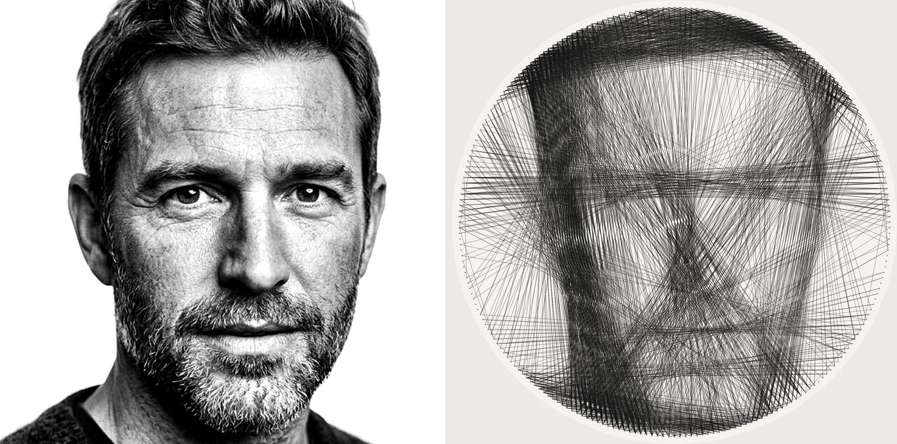

# String Art Studio

String Art Studio turns a photo into a pin-and-thread build plan you can string on a board for about
$50 of materials. It is a small self-hosted web app: tune the image and the board on one page with a
live preview, generate with either of two engines (or both, side by side), export a true-size pin
template and laser or CNC files, then string the piece from your phone with huge pin numbers and voice.



## What it does

- Image editor with crop, zoom and rotation inside the frame, brightness, contrast, gamma, black and
  white points, local contrast (CLAHE), channel mix, edge emphasis, tone presets, a painted importance
  mask (eyes and mouth count more), a viewing-distance preview and optional local background removal.
- Portrait help: faces are detected locally (OpenCV YuNet, bundled), one button frames the face so
  it fills the circle, faces and their features are weighed up automatically, edges count more so
  features stay crisp, and a "Show importance" overlay shows what the optimiser will care about.
- Board configuration in millimetres or inches: diameter, pin count, inset, pin and thread size,
  thread and board colour, inverted (light thread on a dark board), minimum pin skip, maximum lines,
  viewing distance, sector labels. Save any configuration as a preset.
- Two engines that optimise the same thing: make a thread-accurate simulation look like the target
  from a normal viewing distance. The simulation adds light linearly and compares lightness the way
  the eye does, so mid-tones get the thread they really need and the on-screen render looks like the
  finished piece. Lines are scored by the error they remove, so threads that cross areas meant to
  stay light are penalised instead of rewarded. Engine A is a greedy walk with
  refinement passes; engine B builds the best set of chords first and repairs it into one continuous
  thread, reporting what the repair cost.
- Generation runs on the server as a cancellable background job with a live render; every run is kept
  as a version of the project.
- Colour: pick a palette (CMYK, warm skin, earth, primary), your own colours, or let it choose from the
  photo; each colour is one continuous thread, laid lightest first and black last, matched in CIELAB
  from the viewing distance. Build mode stops at every thread change and says what to do.
- Exports: pin template PDF (tiled across Letter or A4 with alignment marks, or one large sheet, with a
  100 mm check bar), SVG and DXF fab files (holes or a notched ring), sequence as TXT, CSV or JSON, the
  render and comparison pictures, and a project bundle ZIP to move a project between instances.
- Build mode for the phone: current and next pin at a size you can read with thread in both hands,
  sector letters, clockwise direction hints, tap or clicker to advance (map any Bluetooth clicker's
  buttons once), auto-advance, voice (Piper in its own container with a clip cache, or the browser's
  speech), background music from a local file ducked under the voice, screen wake lock, and progress
  that resumes on another device.

## Run it

```bash
git clone https://github.com/jbarnell1/string-art-studio.git
cd string-art-studio
docker compose up -d --build
```

Open http://127.0.0.1:8050. Everything it stores is in `./data`. For HTTPS and access from your
phone put Tailscale Serve, Caddy or nginx in front; under a stripped path prefix set `SAS_ROOT_PATH`
(see `.env.example`). Without Docker: `pip install -e . && string-art-studio serve`.

Details: [docs/RUNBOOK.md](docs/RUNBOOK.md) (running, backups, calibration),
[docs/ARCHITECTURE.md](docs/ARCHITECTURE.md) (how the engines work),
[docs/DECISIONS.md](docs/DECISIONS.md) (why), [docs/ROADMAP.md](docs/ROADMAP.md) (what is next).

## Getting a good result

Press "Frame the face" (or crop so the face fills the circle), pick the Portrait preset, push the
background to white with the white point, and keep gamma at 0.75 to 0.8 so skin gets thread. Faces
are weighed up automatically; paint the mask for anything else. Then generate both engines and
compare. Maximum lines is a ceiling, not a target: the engines stop when no line still helps. Expect
3,000 to 6,000 lines and 1 to 2.5 km of thread on a 24 inch board with 240 pins, more for colour. Before buying thread, build one piece and calibrate the thread width and
opacity against it (RUNBOOK, "Calibration").

## Materials for one 24 inch piece

A pre-cut 24 inch round (MDF or edge-glued pine), a can of white primer, a box of 18-gauge brads,
two to three 1,000 yd spools of black heavy-duty polyester thread, and a hanger. Print the template
at 100%, tape it to the board, hammer the brads through the marks, peel the paper, and start at pin 0.

## Status

v1 (generate and compare), v2 (Piper voice, portrait help) and v3 (linear-light engine, colour)
are built; the pilot physical build and its calibration are next. Sample photos in `samples/` are AI-generated fictional people and a
dog. MIT licence.
