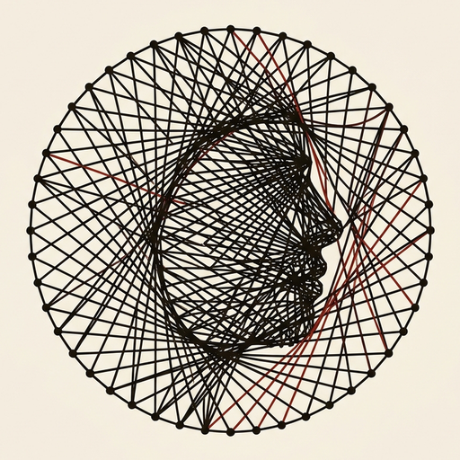
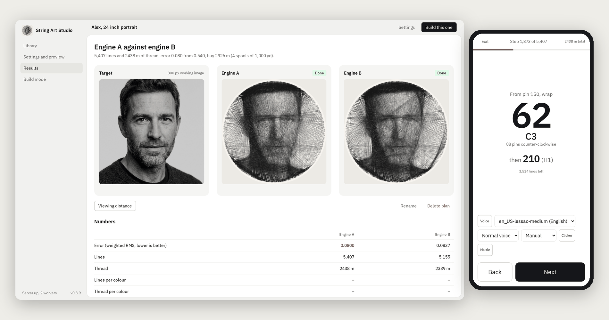
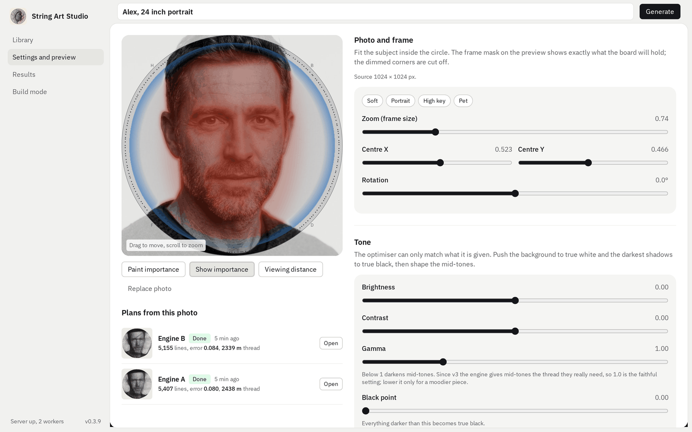
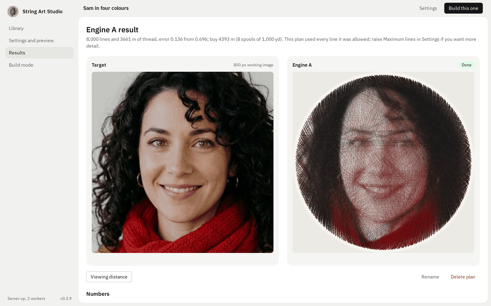
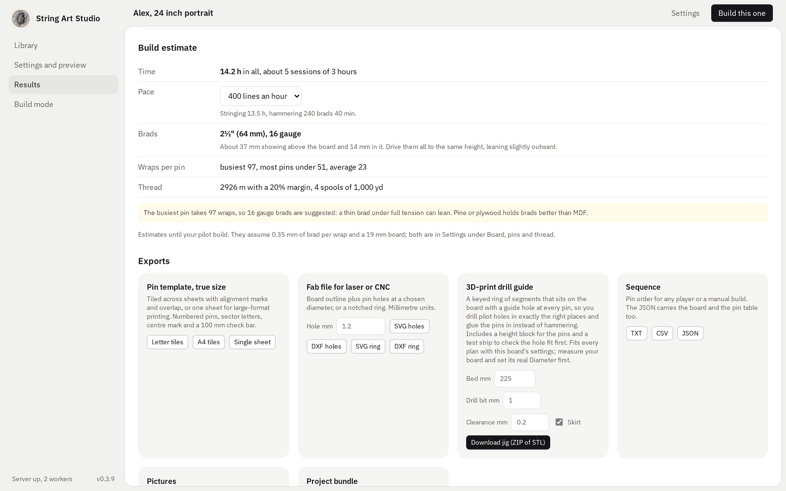
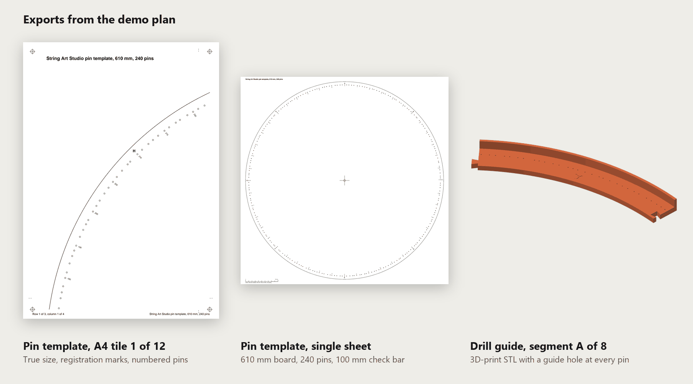
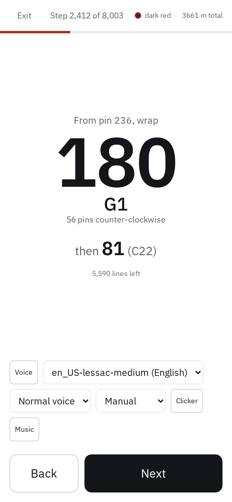

<div align="center">



# String Art Studio

**Turn a photo into a pin-and-thread build plan, then string it from your phone.**

[](https://github.com/jbarnell1/string-art-studio/actions/workflows/ci.yml)
[](LICENSE)
[](https://github.com/jbarnell1/string-art-studio/stargazers)
[](https://github.com/jbarnell1/string-art-studio/commits/main)



</div>

## What it is

String art is one continuous thread wound between a ring of pins until a picture appears. String
Art Studio is a small self-hosted web app that works out which pins, in which order: you tune the
photo and the board on one page with a live preview, generate a plan, export a true-size pin
template, and then string the piece from your phone, which shows (and says) one pin number at a
time.

It was written to replace a retail kit with about $50 of board, brads and thread, and it aims to do
better on portraits than the free generators. The engines do not pile thread onto dark pixels.
They simulate the finished piece, thread by thread, as the eye sees it from across a room, and keep
a line only when it makes that simulation look more like the photo. Lines that cross areas meant
to stay light cost error instead of earning it.

Everything runs on your own machine, on the CPU, in one container. The picture above is the
bundled sample photo (an AI-generated face, not a real person) and what the two engines made of it
in about a minute each.

## Features

- **An image editor built for thread.** Crop, zoom and rotate inside the round frame, set
  brightness, contrast, gamma, black and white points, local contrast and edge emphasis, and see
  the target exactly as the optimiser will see it.
- **Portrait help.** Faces are found on your server (a 227 KB OpenCV model that ships with the
  app). One button frames the face to fill the circle, faces and their features count more, and
  "Show importance" paints what the optimiser will care about. You can paint your own importance
  mask on top.
- **Two engines, one yardstick.** Engine A walks greedily from pin to pin and then refines the
  path with a local search. Engine B picks the best set of chords first and repairs it into one
  continuous thread. Run both and compare them side by side on the same error number.
- **Colour.** Pick a palette, your own thread colours, or let it choose from the photo. Each colour
  is one continuous thread, laid lightest first, matched in CIELAB.
- **A board you can really build.** Millimetres or inches, 100 to 400 pins, pin and thread size,
  light thread on a dark board, and slightly uneven pin spacing so threads do not stack into rings.
- **A build estimate from the plan itself.** Hours at your pace, the brad length and gauge the
  busiest pin needs, metres of thread and spools per colour.
- **True-size exports.** A pin template PDF tiled across Letter or A4 with registration marks (or
  one large sheet), SVG and DXF files for a laser or CNC, the sequence as TXT, CSV or JSON, and a
  project bundle to move a project between installs.
- **A 3D-printable drilling jig.** Keyed ring segments sized to your printer bed with a guide hole
  at every pin, plus a pin height block and a hole-fit test strip.
- **Build mode for the phone.** The current pin at a size you can read with thread in both hands,
  the next pin, sector letters, direction hints, tap or Bluetooth clicker to advance, a local voice
  that reads each pin, a screen wake lock, and progress saved on the server so you can stop and
  pick up on another device.

<p align="center">
  
  
</p>
<p align="center">
  
  
</p>
<p align="center">
  
</p>

All screenshots come from a throwaway demo instance running the photos in `samples/`; see
[docs/screenshots/CREDITS.md](docs/screenshots/CREDITS.md).

## Quick start

With Docker:

```bash
git clone https://github.com/jbarnell1/string-art-studio.git
cd string-art-studio
docker compose up -d --build
```

Open http://127.0.0.1:8050, create a project and upload a photo (or one from `samples/`).
Everything the app stores is in `./data`. The first build takes a few minutes and the image is
about 950 MB.

Without Docker, with [uv](https://docs.astral.sh/uv/) and Python 3.11 or newer:

```bash
git clone https://github.com/jbarnell1/string-art-studio.git
cd string-art-studio
uv sync
uv run string-art-studio serve
```

To have build mode read pin numbers aloud with [Piper](https://github.com/OHF-Voice/piper1-gpl),
copy `.env.example` to `.env`, uncomment the three voice lines and run
`docker compose up -d --build` again. Without it, build mode uses the browser's own speech.

There is no login. The app binds to `127.0.0.1` on purpose; to reach it from a phone, put a VPN
such as Tailscale or a reverse proxy with authentication in front of it (see
[SECURITY.md](SECURITY.md) and the [runbook](docs/RUNBOOK.md)).

## What leaves your server

Your photos, plans and build progress stay in the `data` folder. The server makes no outbound
connections while it runs: no telemetry, no update checks, no accounts, no cloud AI. Face
detection and both engines run locally on the CPU, and the web client loads everything, including
its font (IBM Plex Sans, bundled), from your server only. Two things are worth knowing:

| What | Where it goes | When |
|---|---|---|
| Voice | With the `voice` profile, pin numbers are synthesised by Piper in a second container on the same Docker network and cached on disk. Without it, the browser's built-in speech is used; some browsers send the text ("Pin 37. C 14.") to their vendor's speech service. | Build mode with voice on |
| Background removal | Off by default and not in the image. If you install the optional `bgremove` extra, `rembg` downloads its model (about 170 MB) the first time it is used. | Once, only if you enable it |

Building the images pulls Python packages from PyPI and, for the voice container, the Piper voice
models from Hugging Face. After that both containers work offline.

## Configuration

Every setting is optional. Put them in `.env` next to `compose.yaml` (start from
[`.env.example`](.env.example)).

| Variable | Default | What it does |
|---|---|---|
| `SAS_BIND` | `127.0.0.1` | Host address the port is published on. `0.0.0.0` exposes it to the LAN. |
| `SAS_PORT` | `8050` | Host port. |
| `SAS_DATA` | `./data` | Host folder for photos, plans and the SQLite database. Back this up. |
| `SAS_WORKERS` | `2` | Generation jobs that run at once ("Run both" uses two). |
| `SAS_ROOT_PATH` | empty | Path prefix when a reverse proxy strips one, for example `/stringart`. |
| `COMPOSE_PROFILES`, `SAS_PIPER_URL`, `SAS_PIPER_VOICE` | off | Switch on the Piper voice container and pick its default voice. |
| `SAS_CPUS`, `SAS_MEM` | `4`, `3g` | Container CPU and memory limits. |

Board, thread, tone and engine settings live in the app, per project, and can be saved as presets.
The full list of environment variables is in the [runbook](docs/RUNBOOK.md#environment-variables).

## Documentation

| Document | What it answers |
|---|---|
| [docs/RUNBOOK.md](docs/RUNBOOK.md) | Installing, voice, running behind Tailscale Serve, backups, tips for portraits and colour, building the board, calibration |
| [docs/ARCHITECTURE.md](docs/ARCHITECTURE.md) | How the parts fit, the objective both engines optimise, the API, the storage layout |
| [docs/DECISIONS.md](docs/DECISIONS.md) | Why things are the way they are: 26 short decision records, including what was tried and withdrawn |
| [docs/ROADMAP.md](docs/ROADMAP.md) | What is built and what is next |
| [docs/brief.md](docs/brief.md) | The original product brief |
| [docs/THIRD_PARTY.md](docs/THIRD_PARTY.md) | Bundled third-party files (the font, the face model) and their licenses |
| [CONTRIBUTING.md](CONTRIBUTING.md) | Setting up a dev environment, the checks CI runs, the working rules |
| [SECURITY.md](SECURITY.md) | How to report a vulnerability, and what the app does not protect against |

## Project status and roadmap

Version 0.3.9. It is used by one household and is less than two weeks old, so expect rough edges.
The software side of the brief is built: the editor, both engines, colour, exports, the drilling
jig, and build mode with voice. What is not done yet is the important physical part: a pilot build
to calibrate thread width, opacity and the viewing-distance model against a real piece. Until then
the on-screen render and the build estimate are simulations, not measurements.

Known limits: round boards only, engine B does not do colour, colour palettes are nominal hex
values and not measured thread, and there are no user accounts. For scale, the demo plans in the
screenshots (a 24 inch board with 240 pins) came out at 4,700 to 5,400 lines and about 2.4 km of
thread for one colour, each generated in about a minute on a desktop CPU, with a build estimate of
14 hours at 400 lines an hour. The four-colour plan used its full 8,000 lines and 3.7 km. See
[docs/ROADMAP.md](docs/ROADMAP.md) for what is next.

## How it was built

This project was built with heavy help from [Claude Code](https://claude.com/claude-code). The
owner wrote the brief, made the product decisions and judged the results by eye; Claude Code wrote
most of the code and the docs, and each decision was recorded in
[docs/DECISIONS.md](docs/DECISIONS.md) as it was made. It is tested by 50 pytest tests that need
no network: the engines, colour, image prep, face detection, the voice cache, the build estimate,
the exports, the jig geometry, and an API test that runs a real small generation end to end. CI
runs them with ruff, a Docker build and a secret scan on every push. Engine changes are measured
with `scripts/bench.py` on the sample photos before they are kept. It has not been validated by a
finished physical piece yet.

## Contributing

Bug reports, photos of finished pieces and focused pull requests are welcome. Start with
[CONTRIBUTING.md](CONTRIBUTING.md); everyone taking part is expected to follow the
[code of conduct](CODE_OF_CONDUCT.md).

## Security

There is no login, so keep the app behind your own access control. Report vulnerabilities
privately through the repository's Security tab; details are in [SECURITY.md](SECURITY.md).

## License

MIT, see [LICENSE](LICENSE). Piper runs as a separate GPL-3.0 container and is not part of this
code. The bundled YuNet face model is MIT licensed (`stringart/models/LICENSE-yunet`) and the
bundled IBM Plex Sans font is under the SIL Open Font License 1.1 (`stringart/web/static/fonts/OFL.txt`);
see [docs/THIRD_PARTY.md](docs/THIRD_PARTY.md). The photos in `samples/` are AI-generated fictional
people and a dog, made for this repo.
